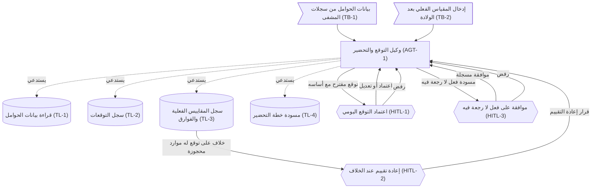

# Agent System Spec: AGENTE
> يرث AGENTE_s0_problem_lock.md و AGENTE_decisions.md. أي تعارض مع S0 → S0 يفوز ويُرفع للإنسان.

## 1. الغاية والنمط
وكيل واحد يحوّل بيانات الحوامل من سجلات المشفى (K-1/K-5) إلى توقع مقيس مبكر لعدد الأطفال الخدج الواصلين (G-1) وحالتهم (G-2)، ويقارن كل توقع بالمقياس الفعلي بعد الولادة (K-6) ويصعّد كل خلاف للإنسان — ليحل محل التخمين بما «يفكر عنه» ويُعتمد عليه (G-3).
- **النمط (DEC-1 مقرر — قرار الإنسان 2026-11-19):** وكيل واحد بأدوات (single agent + tools). لا workflow ولا عدة وكلاء.
- **مستوى الاستقلالية المقترح:** ينفّذ التوقع والتسجيل وحده (سجلات قابلة للتعديل)، وكل ما يمس التحضير الفعلي أو التصرف عند الخلاف أو الأفعال لا الرجعة فيها يتوقف للإنسان — بانتظار قفل الإنسان في القسم 9.

## 2. الجراف

## 3. الوكلاء (Agents)
| ID | الدور | يأخذ | يُخرج | يقرر | لا يقرر | يخدم |
|---|---|---|---|---|---|---|
| AGT-1 | وكيل التوقع والتحضير | بيانات الحوامل من سجلات المشفى (TB-1 عبر TL-1) + المقياس الفعلي بعد الولادة (TB-2) + قرارات الإنسان من HITL-1/HITL-2/HITL-3 | توقع العدد والحالة (صيغته بانتظار DEC-2) + سجل فوارق التوقع/الفعلي + مسودة خطة تحضير + تنبيهات خلاف | كيف يوازن مؤشرات بيانات الحوامل لبناء التوقع؛ ماذا يعرض للإنسان ومتى يصعّد | اعتماد التوقع؛ تنفيذ فعل لا رجعة فيه؛ استخدام مصدر خارج المشفى؛ أي قرار طبي (NG-1/NG-4) | G-1, G-2, G-3, SC-1, SC-2, SC-3 |

## 4. الأدوات (Tools)
| ID | الأداة | قراءة/كتابة | الأثر الجانبي (لا رجعة؟) | من يستدعيها | لماذا يحتاجها |
|---|---|---|---|---|---|
| TL-1 | قراءة بيانات الحوامل من سجلات المشفى | قراءة | لا يوجد | AGT-1 | UF-1 — المصدر الوحيد المسموح (K-1/K-5) لـ G-1/G-2 |
| TL-2 | سجل التوقعات | كتابة | ينشئ سجلات قابلة للتعديل (ليست لا رجعة فيها) | AGT-1 | UF-1 — توثيق التوقع وأساسه قبل اعتماد الإنسان (SC-1/SC-3/EV-3) |
| TL-3 | سجل المقاييس الفعلية والفوارق | قراءة/كتابة | يسجل قياساً فعلياً (K-6) وارتباطه بالتوقع — سجل قابل للتعديل | AGT-1 | UF-2 — حلقة المقارنة (SC-2/EV-2/EV-4/EV-7) |
| TL-4 | مسودة خطة التحضير | كتابة مسودة فقط | مسودة لا تنفيذ — لا أثر لا رجعة فيه | AGT-1 | UF-3 — اقتراح التحضير من التوقع المعتمد (SC-3/EV-3/NG-4) |

## 5. نقاط الإنسان (Human-in-the-loop)
| ID | متى يتوقف النظام | ماذا يُعرض على الإنسان | خياراته | ماذا لو لم يرد | مصدرها |
|---|---|---|---|---|---|
| HITL-1 | قبل أي استخدام للتوقع في التحضير | التوقع (عدد + حالة حسب DEC-2) + أساسه من بيانات الحوامل | اعتماد / تعديل / رفض | لا استخدام للتوقع — يبقى سجلاً معلقاً حتى الرد | NG-4, G-3 |
| HITL-2 | عند خلاف المقياس الفعلي مع توقع حُجزت بناءً عليه موارد | الفارق الموثق + سبب الخلاف + ما تأثر من التوزيع | إعادة تقييم / تعديل التوزيع / إبقاء مع تسجيل السبب | التوزيع المبني على التوقع المنقوض يبقى معلقاً عليه تنبيه متكرر حتى الرد (K-2) | EV-4, EV-7, K-2, U-3 (يحسمها: القرار للإنسان) |
| HITL-3 | قبل أي فعل لا رجعة فيه (نقل/تجهيز/إبلاغ) مبني على التوقع | مسودة الفعل + ارتباطه بالتوقع المعتمد | موافقة مسجلة / رفض | الفعل لا يُنفَّذ إطلاقاً | NG-4, EV-6, K-2 |

## 6. التدفقات (User/Agent Flows)
### UF-1: دورة التوقع اليومي
1. AGT-1 يقرأ بيانات حوامل ولادتها خلال الأسبوع الأخير من الحمل ← عبر TL-1
2. AGT-1 ينتج توقع العدد (G-1) وحالة كل طفل (G-2 — صيغتها حسب DEC-2) مع أساس التوقع ← يسجل في TL-2
3. AGT-1 يعرض التوقع + أساسه على HITL-1
4. اعتماد/تعديل ← يُختم في السجل ويصبح «التوقع المعتمد»؛ رفض ← يعود AGT-1 لمراجعة أساسه ويعيد الاقتراح

**قواعد العمل:**
- BR-1: لا توقع يُستخدم في التحضير قبل اعتماد الإنسان — نعم/لا قابلة للفحص
- BR-3: لا يدخل التوقع إلا من TL-1 (سجلات المشفى) — أي مصدر آخر مرفوض (K-5/EV-5)
- BR-5: التوقع يقتصر على حوامل ولادتها خلال الأسبوع الأخير من الحمل (نطاق G-2/Glossary)

**حالات الحافة:** بيانات ناقصة لحامل ← التوقع يذكر النقص صراحة ولا يخمّن السد؛ غياب أي حامل مؤهلة اليوم ← توقع فارغ موثق لا صمت؛ فشل TL-1/TL-2 ← توقف آمن مع رسالة واضحة ولا توقع جزئي غير موثق.

### UF-2: حلقة المقارنة بعد كل ولادة
1. يُدخل المقياس الفعلي بعد الولادة (TB-2 — طريقة الإدخال: بانتظار DEC-4)
2. AGT-1 يسجل القياس ويحسب الفارق عن التوقع ← TL-3 (K-6)
3. إن كان هناك خلاف على توقع حُجزت بناءً عليه موارد ← تصعيد إلزامي إلى HITL-2

**قواعد العمل:**
- BR-2: كل خلاف فعلي/متوقع يُسجَّل ويُصعَّد — صفر خلاف بلا تسجيل (K-6/EV-7)

**حالات الحافة:** قياس فعلي بلا توقع سابق مسجل ← يسجل ويؤرشف فقط (لا مقارنة ممكنة)؛ خلاف متكرر لنفس النمط ← يظهر في السجل كإشارة تعلم؛ عدم رد الإنسان على HITL-2 ← تنبيه متكرر (جدول التنبيه: قرار تشغيلي لاحق).

### UF-3: التحضير لليوم التالي
1. AGT-1 يشتق مسودة خطة التحضير من التوقع المعتمد حصراً (SC-3/EV-3) ← TL-4
2. أي بند فيها فعل لا رجعة فيه (نقل/تجهيز/إبلاغ) ← يتوقف عند HITL-3
3. الاعتماد البشري يحوّل المسودة إلى خطة تنفيذية؛ الرفض يعيد AGT-1

**قواعد العمل:**
- BR-4: الفعل لا الرجعة فيه لا يُنفَّذ إلا بموافقة بشرية مسجلة (NG-4/EV-6)

**حالات الحافة:** لا توقع معتمد لليوم التالي ← لا مسودة (يعادUF-1)؛ تعديل الإنسان في HITL-1 بعد إنتاج مسودة ← يُعاد توليد المسودة من التوقع المعدل.

## 7. حدود الثقة (Trust Boundaries) — بذرة للتهديدات في S2
| ID | أين يدخل محتوى غير موثوق | يصل إلى أي وكيل/أداة | لماذا خطر |
|---|---|---|---|
| TB-1 | بيانات الحوامل المستوردة من سجلات المشفى (مدخل خارج النظام — قد تكون ناقصة/بتنسيق مختلف/خطأ إدخال) | AGT-1 (عبر TL-1) | توقع مبني على بيانات فاسدة يفسد التحضير وربما لموارد محجوزة (K-2) |
| TB-2 | إدخال المقياس الفعلي بعد الولادة (إدخال بشري من خارج النظام) | AGT-1 (عبر TL-3) | قياس خاطئ يفسد حلقة المقارنة ويطلق تنبيهات خلاف زائفة أو يخفي خلافاً حقيقياً |
| TB-3 | مخرجات AGT-1 نفسها (التوقع المقترح) — تُعالَج كمحتوى غير موثوق حتى اعتماد بشري | HITL-1, TL-2 | لا يُنفَّذ بناءً عليها ولا تُعرض كحقيقة قبل اعتماد الإنسان (NG-4/K-2) |

## 8. معايير القبول
| ID | التدفق | بافتراض (Given) | عندما (When) | إذن (Then) | يغطي EV |
|---|---|---|---|---|---|
| AC-1 | UF-1 | حامل مسجلة في سجلات المشفى وولادتها خلال الأسبوع الأخير | يعمل التوقع اليومي | يظهر توقع العدد + أساسه على HITL-1 قبل أي استخدام في التحضير | EV-1 |
| AC-2 | UF-1 + UF-2 | حامل مسجلة + قياس فعلي بعد الولادة | يُنتج التوقع ثم يُقاس الفعلي | توقع apgar (صيغته حسب DEC-2 — معلّقة) + مقارنة تلقائية بالفعلي + تسجيل الفارق في TL-3 | EV-2 |
| AC-3 | UF-3 | توقع معتمد في HITL-1 | يُعدّ تحضير اليوم التالي | الخطة مشتقة من التوقع المعتمد حصراً (مسودة TL-4) لا من تخمين يدوي | EV-3 |
| AC-4 | UF-2 | توقع معتمد حُجزت بناءً عليه موارد (مثال: حضانة سمارت فل كونترول) | المقياس الفعلي ينقض التوقع | ممنوع بقاء التوزيع بلا إعادة تقييم: تصعيد إلزامي إلى HITL-2 وتنبيه بشري | EV-4 |
| AC-5 | UF-1 | بيانات من خارج سجلات المشفى | تُقدَّم لأي أداة/مسار توقع | ترفض ولا تدخل التوقع إطلاقاً | EV-5 |
| AC-6 | UF-3 | فعل لا رجعة فيه مبني على التوقع | يُطلب تنفيذه | لا تنفيذ دون موافقة بشرية مسجلة في HITL-3 | EV-6 |
| AC-7 | UF-2 | خلاف بين المقياس الفعلي والتوقع | يُكتشف الفارق | تسجيل إلزامي للفارق + تصعيد للإنسان (HITL-2) — صفر خلاف بلا تسجيل | EV-7 |

## 9. حدود الاستقلالية
| الفعل | اقتراح الموديل (✅ وحده / ⚠ بموافقة / ⛔ ممنوع) | السبب (K/NG/EV) | قرار الإنسان |
|---|---|---|---|
| قراءة بيانات الحوامل (TL-1) | ✅ وحده | K-1/K-5 — قراءة فقط، لا أثر جانبي | ______ |
| إنتاج مسودة التوقع وتسجيلها (TL-2) | ✅ وحده | SC-1/SC-3 — سجل قابل للتعديل، يمر عبر HITL-1 قبل أي استخدام | ______ |
| تسجيل المقياس الفعلي والفارق (TL-3) | ✅ وحده | K-6/SC-2 — توثيق لا تنفيذ | ______ |
| استخدام التوقع في التحضير | ⚠ بموافقة HITL-1 | NG-4 — أي اعتماد قرار بشري | ______ |
| التصرف عند خلاف الواقع مع التوقع | ⚠ بموافقة HITL-2 | EV-4/EV-7/K-2 + يحسم U-3 | ______ |
| اعتماد خطة التحضير (TL-4) | ⚠ بموافقة (HITL-1/HITL-3) | SC-3/NG-4 | ______ |
| تنفيذ فعل لا رجعة فيه (نقل/تجهيز/إبلاغ) | ⛔ ممنوع دون موافقة مسجلة | NG-4/EV-6/K-2 | ______ |
| استخدام مصدر خارج سجلات المشفى | ⛔ ممنوع | NG-2/K-5/EV-5 | ______ |
| تشخيص أو قرار طبي على الطفل | ⛔ ممنوع | NG-1 | ______ |

## 10. قرارات S1
### DEC-4: كيف يصل المقياس الفعلي (K-6) إلى النظام؟ — المرحلة S1
| الخيار | يناسب لأن | الثمن / الخطر | التكلفة التقريبية | مرتبط بـ |
|---|---|---|---|---|
| أ) إدخال يدوي بسيط بعد كل ولادة | أبسط ما يمكن (MVP) — لا يعتمد على تكاملات غير مثبتة؛ يطابق «الأبسط أولاً» | إدخال بشري = خطر نسيان/خطأ يفسد TB-2 وحلقة SC-2 | الأقل [تقدير] | K-6, SC-2, TB-2 |
| ب) استقبال آلي من سجل ولادات المشفى | يقلل خطأ الإدخال البشري ويغلق فجوة النسيان | يتطلب تكاملاً مع أنظمة المشفى لم تُنص على توفرها في S0 — خطر [افتراض] غير مؤكد | أعلى [تقدير] | K-5, K-6 |
| ج) يدوي الآن + استقبال آلي لاحقاً بعد التحقق من توفر التكامل | يبدأ بالأبسط دون إغلاق الباب | تكلفة تحويل لاحقة + فترة انتقالية بنظامين | متوسط [تقدير] | K-6, SC-2 |

**توصية (استشارية):** أ — لا يوجد في S0 دليل على توفر تكامل آلي (K-5 ينص على سجلات المشفى كمصدر بيانات الحوامل فقط)، وإدخال يدوي بضوابط تدقيق (TB-2) يحقق SC-2 من اليوم الأول؛ الخيار ب يُبنى على [افتراض] غير مؤكد.
**قرار الإنسان:** ______  **السبب:** ______  **التاريخ:** ______

### DEC-5: متى يتوقف النظام عند HITL-1 لاعتماد التوقع؟ — المرحلة S1
| الخيار | يناسب لأن | الثمن / الخطر | التكلفة التقريبية | مرتبط بـ |
|---|---|---|---|---|
| أ) مرة يومياً بدفعة واحدة (توقع اليوم كاملاً) | عبء قرار واحد يومي على صاحب الحضانة — واقعي تشغيلياً | تأخر اعتماد الحالة العالية حتى نهاية الدورة؛ تأخر قياس SC-1/SC-3 | الأقل [تقدير] | SC-1, SC-3 |
| ب) لكل حامل لحظة اكتشاف ولادتها مقررة خلال الأسبوع الأخير | استجابة أسرع لكل حالة | عدة نقاط توقف يومياً = إرهاق قرار قد يؤدي إلى موافقات آلية بلا قراءة — يهدد روح NG-4 | أعلى [تقدير: نقطة توقف لكل حامل/يوم] | NG-4, K-2 |
| ج) دفعة يومية + تنبيه فوري مستقل للحالات ذات المؤشرات العالية | يوازن العبء مع سرعة الاستجابة للحالة الحرجة (K-2) | يحتاج تعريف «مؤشرات عالية» من بيانات الحوامل — قرار تصميمي إضافي في S2 | متوسط [تقدير] | K-2, G-2, SC-2 |

**توصية (استشارية):** ج — K-2 يفرض ألا تنتظر الحالة الحرجة دورة يومية كاملة، وعبء القرار يبقى يومياً واحداً؛ البديل ب يهدد جودة القرار البشري نفسه.
**قرار الإنسان:** ______  **السبب:** ______  **التاريخ:** ______

## 11. أسئلة للإنسان
1. **DEC-2 معلّق (من S0):** صيغة توقع apgar — قيمة رقمية / فئة خطر / الاثنان — أثرها على مخرجات AGT-1 وAC-2. يُقفل قبل S2.
2. **DEC-3 معلّق (من S0):** عتبات قبول SC-1/SC-2/SC-3 — أثرها على قياس النجاح في S5/S6. يُقفل قبل S2. *(ملاحظة: نهاية DEC-3 في decisions.md لم تصلني كاملة بسبب اقتطاع قراءة الملف — يرجى تأكيد إن كان قرارك مكتوباً فيها.)*
3. **ترقيم القرارات:** هل توجد قرارات بعد DEC-3 في decisions.md؟ إن وُجدت، سأعيد ترقيم DEC-4/DEC-5 أعلاه من بعدها.
4. **K-2:** ورد في S0 كـ [افتراض] — هل تؤكد أن هامش الخطأ في هذا السياق ضئيل جداً؟ كل نقاط HITL مبنية عليه.
5. **«حضانة سمارت فل كونترول»:** تفسيره الدقيق (أعلى تجهيز للحضانة؟) يحتاج تأكيداً — ورد في AC-4/EV-4.
6. **U-1 متبقٍ:** ملكية بيانات الحوامل وصلاحية استخدامها التشغيلي الداخلي — [افتراض] ملكية المشفى — يُؤكد في البوابة.
