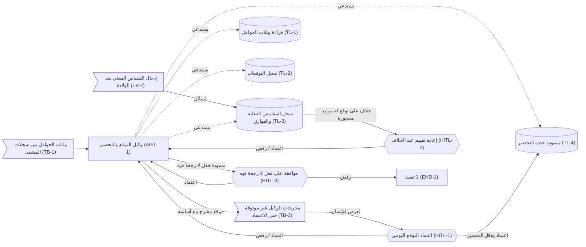

# Agent System Spec: AGENTE
> يرث AGENTE_s0_problem_lock.md و AGENTE_decisions.md. أي تعارض مع S0 → S0 يفوز ويُرفع للإنسان.
> v1.3 — تبسيط الجراف (DEC-8 2026-11-19): سهم راجع واحد لكل HITL، رفض HITL-3 → نهاية END-1 «لا تنفيذ»، TB-3 عقدة صريحة على السهم AGT-1 → HITL-1، الاتجاه LR.
> v1.2 — تعديلات القرار الإنساني 2026-11-19: AC-2 يغطي EV-1، أُضيف AC-9 لـ EV-2 (البيانات الناقصة)، جدول EV النهائي بقرار DEC-7 (s0_skill.md صار v1.2).
> ملاحظة أمانة: أقسام ما بعد §4 (منتصف جدول الأدوات حتى النهاية) أعيد بناؤها لأن قراءة الملف السابقة كانت مقصوصة عند المحرك — راجعها عند البوابة.

## 1. الغاية والنمط
وكيل واحد يحوّل بيانات الحوامل من سجلات المشفى (K-1/K-5) إلى توقع مقيس مبكر لعدد الأطفال الخدج الواصلين (G-1) وحالتهم (G-2)، ويقارن كل توقع بالمقياس الفعلي بعد الولادة (K-6) ويصعّد كل خلاف للإنسان — ليحل محل التخمين بما «يفكر عنه» ويُعتمد عليه (G-3).
- **النمط (DEC-1 مقرر — قرار الإنسان 2026-11-19):** وكيل واحد بأدوات (single agent + tools). لا workflow ولا عدة وكلاء.
- **مستوى الاستقلالية المقترح:** ينفّذ التوقع والتسجيل وحده (سجلات قابلة للتعديل)، وكل ما يمس التحضير الفعلي أو التصرف عند الخلاف أو الأفعال لا الرجعة فيها يتوقف للإنسان — بانتظار قفل الإنسان في القسم 9.

## 2. الجراف

> عقدة النهاية END-1 «لا تنفيذ»: رفض HITL-3 يذهب إليها مباشرة ولا يعود للوكيل (DEC-8) — يعزز BR-4/EV-5.
> سهم راجع واحد لكل HITL بلاحقة «اعتماد / رفض» (HITL-1/HITL-2)؛ سهم اعتماد HITL-3 يحمل «اعتماد» والرفض مستقل إلى END-1.

## 3. الوكلاء (Agents)
| ID | الدور | يأخذ | يُخرج | يقرر | لا يقرر | يخدم |
|---|---|---|---|---|---|---|
| AGT-1 | وكيل التوقع والتحضير | بيانات الحوامل من سجلات المشفى (TB-1 عبر TL-1) + المقياس الفعلي بعد الولادة (TB-2 عبر TL-3) + قرارات الإنسان من HITL-1/HITL-2/HITL-3 | توقع العدد والحالة (صيغته بانتظار DEC-2) + سجل فوارق التوقع/الفعلي + مسودة خطة تحضير + تنبيهات خلاف | كيف يوازن مؤشرات بيانات الحوامل لبناء التوقع؛ ماذا يعرض للإنسان ومتى يصعّد | اعتماد التوقع؛ تنفيذ فعل لا رجعة فيه؛ استخدام مصدر خارج المشفى؛ أي قرار طبي (NG-1/NG-4) | G-1, G-2, G-3, SC-1, SC-2, SC-3 |

## 4. الأدوات (Tools)
| ID | الأداة | قراءة/كتابة | الأثر الجانبي (لا رجعة؟) | من يستدعيها | لماذا يحتاجها |
|---|---|---|---|---|---|
| TL-1 | قراءة بيانات الحوامل من سجلات المشفى | قراءة | لا يوجد | AGT-1 | UF-1 — المصدر الوحيد المسموح (K-1/K-5) لـ G-1/G-2 |
| TL-2 | سجل التوقعات | كتابة | ينشئ سجلات قابلة للتعديل (ليست لا رجعة فيها) | AGT-1 | UF-1 — توثيق التوقع وأساسه قبل اعتماد الإنسان (SC-1/SC-3) |
| TL-3 | سجل المقاييس الفعلية والفوارق | قراءة/كتابة | يسجل قياساً فعلياً (K-6) وارتباطه بالتوقع — سجل قابل للتعديل | AGT-1 | UF-2 — حلقة المقارنة (SC-2/EV-6/EV-4/EV-7)؛ مدخلها الخارجي TB-2 يُسجَّل عبرها |
| TL-4 | مسودة خطة التحضير | كتابة مسودة فقط | لا تنفيذ — مسودة قابلة للتعديل؛ لا يلمس الواقع | AGT-1 | UF-1/UF-3 — يجهّز التحضير المقترح؛ اعتماد HITL-1 يفعّله (SC-3) |

## 5. نقاط الإنسان (Human-in-the-loop)
| ID | متى يتوقف النظام | ماذا يُعرض على الإنسان | خياراته | ماذا لو لم يرد | مصدرها |
|---|---|---|---|---|---|
| HITL-1 | قبل أي استخدام للتوقع في التحضير | التوقع المقترح + أساسه الموثق + أي حقول ناقصة في بياناته (EV-2) | اعتماد / تعديل / رفض | التوقع يبقى معلقاً بلا استخدام (BR-1) | NG-4 |
| HITL-2 | عند خلاف المقياس الفعلي مع توقع له موارد محجوزة | التوقع المنقوض، المقياس الفعلي، الفارق، الموارد المحجوزة | إعادة تقييم / تعديل توزيع / إبقاء مع تسجيل السبب | تنبيه متكرر ولا بقاء للتوزيع المنقوض بلا معالجة (K-2) | U-3 / EV-7 |
| HITL-3 | قبل أي فعل لا رجعة فيه (نقل/تجهيز/إبلاغ) مبني على التوقع | الفعل المقترح + التوقع الذي بُني عليه + بدائل إن وجدت | موافقة مسجلة / رفض | الفعل لا يُنفَّذ (BR-4) | NG-4 / EV-5 |

> **END-1:** عقدة نهاية «لا تنفيذ» في الجراف — رفض HITL-3 يذهب إليها مباشرة ولا يعود للوكيل (DEC-8).

## 6. التدفقات (User/Agent Flows)
### UF-1: التوقع اليومي والتحضير
1. AGT-1 يقرأ بيانات الحوامل عبر TL-1 (المصدر الوحيد — BR-3)
2. AGT-1 يبني توقع العدد والحالة (صيغتها بانتظار DEC-2) ويثبته في TL-2 بأساس موثق
3. إن كانت بيانات حامل ناقصة حقول: يوثّق النقص صراحة ولا يملؤه بقيم مخترعة (EV-2/AC-9)
4. AGT-1 يعرض التوقع على HITL-1 (عبر TB-3 — مخرجات الوكيل غير موثوقة حتى الاعتماد) → اعتماد/تعديل/رفض
5. عند الاعتماد: يفعّل مسودة خطة التحضير في TL-4
**قواعد العمل:** BR-1: لا استخدام للتوقع قبل اعتماد الإنسان (NG-4) · BR-3: لا مصدر للتوقع إلا TL-1 (K-5) · BR-5: التوقع يقتصر على حوامل ولادتها خلال الأسبوع الأخير من الحمل
**حالات الحافة:** بيانات ناقصة (EV-2) — مصدر خارجي مقترح (EV-3: يُرفض ويوثَّق) — فشل قراءة TL-1 (يتوقف الدور ولا توقع من بيانات بديلة) — لم يرد الإنسان في HITL-1 (التوقع معلق)

### UF-2: المقارنة بعد الولادة
1. المقياس الفعلي يدخل من TB-2 ويُسجَّل عبر TL-3 (قرار DEC-4 للطريقة معلّق)
2. AGT-1 يقارن بكل توقع معتمد ذي صلة ويسجل الفارق في TL-3 (EV-6)
3. عند خلاف يخص توقعاً له موارد محجوزة: يفتح HITL-2 (EV-4/EV-7) → قراره راجع إلى AGT-1 بسهم واحد «اعتماد / رفض»
**قواعد العمل:** BR-2: صفر خلاف فعلي/متوقع بلا تسجيل وتصعيد (K-6)
**حالات الحافة:** مقياس بلا توقع مطابق (يُسجل كفارق غير مبرمج) — توقع بلا ولادة (يبقى مفتوحاً حتى الإغلاق أو الإلغاء) — لم يرد الإنسان في HITL-2 (تنبيه متكرر)

### UF-3: فعل لا رجعة فيه
1. AGT-1 يولّد مسودة فعل (نقل/تجهيز/إبلاغ) في TL-4 كمسودة فقط
2. تُعرض على HITL-3 → اعتماد (موافقة مسجلة، راجع إلى AGT-1) أو رفض → نهاية «لا تنفيذ» (END-1)
**قواعد العمل:** BR-4: فعل لا رجعة فيه = موافقة بشرية مسجلة قبل التنفيذ (NG-4/EV-5)
**حالات الحافة:** لم يرد الإنسان (الفعل لا يُنفَّذ) — رفض → نهاية «لا تنفيذ» (END-1) مع توثيق الحالة

## 7. حدود الثقة (Trust Boundaries) — بذرة للتهديدات في S2
| ID | أين يدخل محتوى غير موثوق | يصل إلى أي وكيل/أداة | لماذا خطر |
|---|---|---|---|
| TB-1 | بيانات الحوامل المستوردة من سجلات المشفى | AGT-1 (عبر TL-1) | خطأ/نقص في المصدر ينعكس على التوقع وقرارات التحضير — لا تفترض اكتمالها أو صحتها |
| TB-2 | إدخال المقياس الفعلي بعد الولادة (إدخال بشري) | AGT-1 (عبر TL-3) | خطأ إدخال يشوّه حلقة المقارنة والخلاف — يدخل النظام عبر TL-3 حصراً |
| TB-3 | مخرجات AGT-1 نفسها | HITL-1/HITL-2/HITL-3 والنظام كله — في الجراف: عقدة صريحة على السهم AGT-1 → HITL-1 (DEC-8) | لا تنفّذ ولا تعرض بناءً عليها كحقيقة قبل اعتماد بشري |

## 8. معايير القبول
| ID | التدفق | بافتراض (Given) | عندما (When) | إذن (Then) | يغطي EV |
|---|---|---|---|---|---|
| AC-1 | UF-1 | حوامل خديج مسجلات في سجلات المشفى (TL-1) | عند دورة التوقع اليومي | توقع العدد موثق في TL-2 بأساسه قبل HITL-1 | EV-1 |
| AC-2 | UF-1 | حامل خديج مسجلة | عند بناء توقع الحالة (apgar) لكل طفل متوقع | توقع الحالة موثق بأساسه في TL-2 قبل HITL-1 | EV-1 |
| AC-3 | UF-1 | محاولة استخدام مصدر بيانات خارج المشفى | عندما يُقترح أو يدخل مصدر خارجي | يرفض AGT-1 استخدامه ويوثق الرفض (K-5) | EV-3 |
| AC-4 | UF-2 | مورد محجوز بناءً على توقع | عندما ينقض المقياس الفعلي التوقع | يُسجل الفارق في TL-3 ويُفتح HITL-2 قبل أي بقاء للتوزيع | EV-4 |
| AC-5 | UF-3 | مسودة فعل لا رجعة فيه | عندما يولّد AGT-1 مسودة فعل | لا تنفيذ إلا بموافقة مسجلة من HITL-3 — وعند الرفض: نهاية «لا تنفيذ» (END-1) | EV-5 |
| AC-6 | UF-2 | ولادة فعلية بمقياس مسجل (K-6) | عند تسجيل المقياس عبر TL-3 | يُقارن بكل توقع معتمد ذي صلة ويُسجل الفارق | EV-6 |
| AC-7 | UF-2 | خلاف بين المقياس الفعلي والتوقع | عند كشف الخلاف | تسجيل + تصعيد للإنسان (HITL-2) — لا صمت | EV-7 |
| AC-8 | UF-1/UF-2 | توقع معتمد | عند بناء تحضير اليوم التالي | التحضير مبني على التوقع المعتمد لا التخمين — **معيار القياس (EV) يُحدَّد بقرار الإنسان** | يُحدَّد (SC-3) |
| AC-9 | UF-1 | حامل خديج بحقول ناقصة في سجلات المشفى | عندما يبني AGT-1 توقعاً لها | يوثق الحقول الناقصة صراحة في أساس التوقع، لا يملؤها بقيم مخترعة، ويعرض النقص على الإنسان في HITL-1 | EV-2 |

## 9. حدود الاستقلالية
| الفعل | اقتراح الموديل (✅ وحده / ⚠ بموافقة / ⛔ ممنوع) | السبب (K/NG/EV) | قرار الإنسان |
|---|---|---|---|
| قراءة بيانات الحوامل (TL-1) | ✅ وحده | K-1/K-5 | ______ |
| إنتاج مسودة التوقع وتسجيلها (TL-2) | ✅ وحده | سجلات قابلة للتعديل — SC-1/SC-2 | ______ |
| تسجيل المقياس الفعلي والفوارق (TL-3) | ✅ وحده | K-6/EV-6 | ______ |
| استخدام التوقع في التحضير (TL-4) | ⚠ بموافقة HITL-1 | NG-4/EV-1 | ______ |
| التصرف عند الخلاف (HITL-2) | ⚠ بموافقة HITL-2 | U-3/EV-7 | ______ |
| فعل لا رجعة فيه | ⚠ بموافقة HITL-3 المسجلة — وممنوع بلا تسجيل؛ الرفض → نهاية «لا تنفيذ» (END-1) | NG-4/EV-5 | ______ |
| مصدر بيانات خارج المشفى | ⛔ ممنوع | K-5/EV-3 | ______ |
| أي تشخيص أو قرار طبي | ⛔ ممنوع | NG-1 | ______ |

## 10. قرارات S1
### DEC-4: كيف يصل المقياس الفعلي إلى TL-3؟ — المرحلة S1
| الخيار | يناسب لأن | الثمن / الخطر | التكلفة التقريبية | مرتبط بـ |
|---|---|---|---|---|
| أ) إدخال يدوي | أبسط وأسرع إطلاقاً؛ TB-2 يمر عبر TL-3 مع تدقيق بشري | تأخير/خطأ إدخال يبطئ حلقة المقارنة | الأدنى [تقدير] | K-6, EV-6 |
| ب) تكامل آلي مع سجلات المشفى | يلغي خطأ الإدخال ويسرّع الحلقة | يعتمد على إتاحة واجهة سجلات المشفى — قرار معماري S2 | أعلى [تقدير] | K-6, K-2 |
| ج) هجين (يدوي الآن + آلي لاحقاً) | يطلق MVP سريعاً ويحفظ مسار الأتمتة | تكلفة انتقال لاحقة | متوسط [تقدير] | SC-2 |

**توصية (استشارية):** أ — يدوي أولاً: أبسط مسار يحقق حلقة المقارنة (EV-6) ويناسب MVP، والانتقال لـ ج لاحقاً ممكن بلا إعادة تصميم الجراف.
**قرار الإنسان:** ______  **السبب:** ______  **التاريخ:** ______

### DEC-5: توقيت اعتماد التوقع في HITL-1 — المرحلة S1
| الخيار | يناسب لأن | الثمن / الخطر | التكلفة التقريبية | مرتبط بـ |
|---|---|---|---|---|
| أ) دفعة يومية واحدة | روتين ثابت يقلل مقاطعة الإنسان | تأخير الاستجابة لولادات بينية | الأدنى [تقدير] | SC-1 |
| ب) لكل حامل على حدة | دقة متابعة فردية | عبء مراجعة يومي متكرر | أعلى [تقدير] | K-2 |
| ج) دفعة يومية + تنبيه فوري للحالات الحرجة | توازن الروتين مع K-2 للحالة الحرجة | يحتاج تعريف «حرجة» (مرتبط بـ DEC-2) | متوسط [تقدير] | K-2, EV-4 |

**توصية (استشارية):** ج — الدفعة اليومية تغذي SC-1/SC-3، والتنبيه الفوري يحمي الحالة الحرجة (K-2/EV-4)؛ تعتمد ج على حسم DEC-2.
**قرار الإنسان:** ______  **السبب:** ______  **التاريخ:** ______

> DEC-6 و DEC-7 و DEC-8 (ترقيم EV النهائي وتبسيط الجراف) موثقة في AGENTE_decisions.md — مصدر الحقيقة.

## 11. أسئلة للإنسان
1. **SC-3 بلا سيناريو تقييم:** «تحضير اليوم التالي» فقد EV-3 بالترقيم الجديد (صار EV-3 = مصدر خارجي). أي EV يقيسه؟ AC-8 معلَّمة كـ«يُحدَّد» حتى قرارك.
2. **AC-2 ↔ EV-1:** ربطت AC-2 بـ EV-1 بقرارك — لكن نص EV-1 في s0_skill v1.2 يقول «توقع قبل الوصول» وأضفت له جملة توقع الحالة. هل يوسَّع نص EV-1 صراحة إلى «توقع العدد والحالة»؟
3. **دمج سيناريو v1.1:** سيناريو «توقع apgar لكل طفل + مقارنة» (كان EV-2 في v1.1) دُمج ضمن EV-6 (مقارنة التوقع) — تأكيد.
4. **تفسير تبسيط الجراف (DEC-8):** طبقت «سهم راجع واحد بعنوان اعتماد / رفض» على HITL-1 وHITL-2؛ وHITL-3 صار سهمه الراجع «اعتماد» فقط والرفض ذهب لعقدة النهاية END-1 — تأكيد أن هذا مقصود.
5. **معلّقات:** DEC-2 (صيغة apgar)، DEC-3 (العتبات)، DEC-4 (وصول المقياس)، DEC-5 (توقيت الاعتماد) — لا يُبنى عليها كأنها محسومة.
6. **حذف ملف:** AGENTE_decisions_s1.md صار شاهدة قبر — احذفه يدوياً من الريبو (لا أملك أداة حذف)، وحدّث خانة S1 في سجل الخانات.
