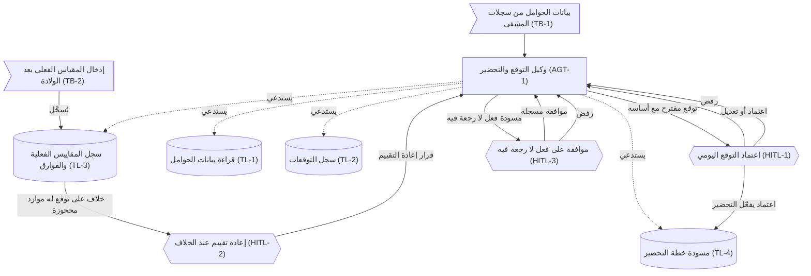

# Agent System Spec: AGENTE
> يرث AGENTE_s0_problem_lock.md و AGENTE_decisions.md. أي تعارض مع S0 → S0 يفوز ويُرفع للإنسان.
> v1.1 — أعيد توليده بعد تصحيحات الإنسان (ترقيم EV بقرار DEC-6، تعديلات الجراف). أقسام §5–§11 أعيد بناؤها لأن قراءة الملف الأصلي كانت مقصوصة عند المحرك؛ راجعها عند البوابة.

## 1. الغاية والنمط
وكيل واحد يحوّل بيانات الحوامل من سجلات المشفى (K-1/K-5) إلى توقع مقيس مبكر لعدد الأطفال الخدج الواصلين (G-1) وحالتهم (G-2)، ويقارن كل توقع بالمقياس الفعلي بعد الولادة (K-6) ويصعّد كل خلاف للإنسان — ليحل محل التخمين بما «يفكر عنه» ويُعتمد عليه (G-3).
- **النمط (DEC-1 مقرر — قرار الإنسان 2026-11-19):** وكيل واحد بأدوات (single agent + tools). لا workflow ولا عدة وكلاء.
- **مستوى الاستقلالية المقترح:** ينفّذ التوقع والتسجيل وحده (سجلات قابلة للتعديل)، وكل ما يمس التحضير الفعلي أو التصرف عند الخلاف أو الأفعال لا الرجعة فيها يتوقف للإنسان — بانتظار قفل الإنسان في القسم 9.

## 2. الجراف

## 3. الوكلاء (Agents)
| ID | الدور | يأخذ | يُخرج | يقرر | لا يقرر | يخدم |
|---|---|---|---|---|---|---|
| AGT-1 | وكيل التوقع والتحضير | بيانات الحوامل من سجلات المشفى (TB-1 عبر TL-1) + المقياس الفعلي بعد الولادة (TB-2 عبر TL-3) + قرارات الإنسان من HITL-1/HITL-2/HITL-3 | توقع العدد والحالة (صيغته بانتظار DEC-2) + سجل فوارق التوقع/الفعلي + مسودة خطة تحضير + تنبيهات خلاف | كيف يوازن مؤشرات بيانات الحوامل لبناء التوقع؛ ماذا يعرض للإنسان ومتى يصعّد | اعتماد التوقع؛ تنفيذ فعل لا رجعة فيه؛ استخدام مصدر خارج المشفى؛ أي قرار طبي (NG-1/NG-4) | G-1, G-2, G-3, SC-1, SC-2, SC-3 |

## 4. الأدوات (Tools)
| ID | الأداة | قراءة/كتابة | الأثر الجانبي (لا رجعة؟) | من يستدعيها | لماذا يحتاجها |
|---|---|---|---|---|---|
| TL-1 | قراءة بيانات الحوامل من سجلات المشفى | قراءة | لا يوجد | AGT-1 | UF-1 — المصدر الوحيد المسموح (K-1/K-5) لـ G-1/G-2 |
| TL-2 | سجل التوقعات | كتابة | ينشئ سجلات قابلة للتعديل (ليست لا رجعة فيها) | AGT-1 | UF-1 — توثيق التوقع وأساسه قبل اعتماد الإنسان (SC-1/SC-3) |
| TL-3 | سجل المقاييس الفعلية والفوارق | قراءة/كتابة | يسجل قياساً فعلياً (K-6) وارتباطه بالتوقع — سجل قابل للتعديل | AGT-1 | UF-2 — حلقة المقارنة (SC-2/EV-6/EV-4/EV-7)؛ مدخلها الخارجي TB-2 يُسجَّل عبرها |
| TL-4 | مسودة خطة التحضير | كتابة مسودة فقط | مسودة لا تنفيذ — لا أثر لا رجعة فيه | AGT-1 | UF-3 — اقتراح التحضير من التوقع المعتمد (SC-3/NG-4)؛ يفعّلها اعتماد HITL-1 |

## 5. نقاط الإنسان (Human-in-the-loop)
| ID | متى يتوقف النظام | ماذا يُعرض على الإنسان | خياراته | ماذا لو لم يرد | مصدرها |
|---|---|---|---|---|---|
| HITL-1 | قبل أي استخدام للتوقع في التحضير | التوقع + أساسه من بيانات الحوامل | اعتماد/تعديل/رفض | التوقع يبقى معلقاً بلا استخدام | NG-4 |
| HITL-2 | عند خلاف المقياس الفعلي مع توقع حُجزت بناءً عليه موارد | الفارق الموثق وسبب الخلاف | إعادة تقييم/تعديل التوزيع/إبقاء مع تسجيل السبب | تنبيه متكرر؛ لا بقاء للتوزيع المنقوض بلا معالجة | U-3/EV-4/EV-7/K-2 |
| HITL-3 | قبل أي فعل لا رجعة فيه (نقل/تجهيز/إبلاغ) مبني على التوقع | مسودة الفعل وارتباطه بالتوقع المعتمد | موافقة مسجلة/رفض | الفعل لا يُنفَّذ | NG-4/EV-5 |

## 6. التدفقات (User/Agent Flows)
### UF-1: دورة التوقع
1. AGT-1 يقرأ بيانات الحوامل عبر TL-1 (المصدر الوحيد المسموح).
2. AGT-1 ينتج توقع العدد (EV-1) وتوقع الحالة لكل طفل متوقع (EV-2) مع توثيق الأساس.
3. AGT-1 يسجّل التوقع في TL-2.
4. AGT-1 يعرض التوقع على HITL-1؛ اعتماد/تعديل/رفض.
5. الاعتماد يفعّل مسودة التحضير في TL-4.
**قواعد العمل:** BR-1: لا استخدام للتوقع قبل اعتماد الإنسان (نعم/لا: هل وُجد استخدام قبل الاعتماد؟). BR-3: لا مصدر للتوقع إلا TL-1 حصراً. BR-5: التوقع يقتصر على حوامل ولادتها خلال الأسبوع الأخير من الحمل.
**حالات الحافة:** بيانات ناقصة أو متأخرة → التوقع يشير إلى النقص ولا يُقدَّم كحقيقة (TB-1)؛ فشل قراءة TL-1 → لا توقع ويُبلَّغ الإنسان؛ لا استجابة من HITL-1 → التوقع معلّق.

### UF-2: حلقة المقارنة والخلاف
1. بعد كل ولادة يُسجَّل المقياس الفعلي عبر TL-3 (مدخل TB-2).
2. AGT-1 يقارن كل توقع مسجّل بالمقياس الفعلي ويسجّل الفارق (EV-6).
3. خلاف → تسجيل وتصعيد HITL-2 (EV-7).
4. توقع منقوض له موارد محجوزة → إعادة تقييم وتنبيه بشري إلزاميان (EV-4).
**قواعد العمل:** BR-2: صفر خلاف فعلي/متوقع بلا تسجيل وتصعيد (نعم/لا: هل مرّ خلاف بلا تصعيد؟).
**حالات الحافة:** مقياس مفقود أو متأخر → المقارنة معلقة ويُنبَّه الإنسان؛ إدخال مشتبه به → وسم تدقيق (TB-2)؛ خلاف على توقع بلا موارد محجوزة → يُسجَّل بلا تصعيد فوري.

### UF-3: تحضير اليوم التالي
1. AGT-1 يبني مسودة تحضير من التوقع المعتمد فقط في TL-4.
2. المسودة عرض للإنسان — لا تنفيذ آلي.
**قواعد العمل:** BR-1 (كما أعلاه). BR-4: فعل لا رجعة فيه = موافقة بشرية مسجلة قبل التنفيذ (نعم/لا: هل نُفِّذ فعل بلا موافقة مسجلة؟).
**حالات الحافة:** لا توقع معتمد → لا مسودة؛ خلاف مفتوح على توقع ذي صلة → المسودة تحمل تحذيراً؛ لا استجابة من HITL-3 → الفعل لا يُنفَّذ.

## 7. حدود الثقة (Trust Boundaries) — بذرة للتهديدات في S2
| ID | أين يدخل محتوى غير موثوق | يصل إلى أي وكيل/أداة | لماذا خطر |
|---|---|---|---|
| TB-1 | بيانات الحوامل المستوردة من سجلات المشفى | AGT-1 (عبر TL-1) | خطأ أو تلاعب بالبيانات يفسد التوقع وأساسه |
| TB-2 | إدخال المقياس الفعلي بعد الولادة (إدخال بشري) | TL-3 ثم AGT-1 | إدخال خاطئ/متعمد يولّد خلافاً زائفاً أو يخفي خلافاً حقيقياً |
| TB-3 | مخرجات AGT-1 نفسها | HITL-1/HITL-2/HITL-3 والعرض | الخطأ النموذجي قد يُقبل كحقيقة إن لم يُعلَّم كتوقع |

## 8. معايير القبول
| ID | التدفق | بافتراض (Given) | عندما (When) | إذن (Then) | يغطي EV |
|---|---|---|---|---|---|
| AC-1 | UF-1 | حامل خديج مسجلة ولادتها مقررة خلال الأسبوع الأخير | دورة توقع تشتغل | توقع عدد مبني على TL-1 حصراً ويُسجَّل في TL-2 قبل أي عرض | EV-1 |
| AC-2 | UF-1 | نفس الحامل | يبني الوكيل التوقع | توقع حالة (apgar) لكل طفل متوقع بالصيغة المحسومة في DEC-2 مع توثيق الأساس | EV-2 |
| AC-3 | UF-1 | بيانات من مصدر خارج سجلات المشفى تظهر عند الوكيل | يتعامل معها الوكيل | ممنوع استخدامها في التوقع؛ الرفض مسجل | EV-3 |
| AC-4 | UF-2 | توقع معتمد حُجزت بناءً عليه موارد + مقياس فعلي ينقضه | يُسجَّل المقياس في TL-3 | يُفتح HITL-2 فوراً ولا يبقى التوزيع بلا إعادة تقييم وتنبيه بشري | EV-4 |
| AC-5 | UF-3 | مسودة فعل لا رجعة فيه (نقل/تجهيز/إبلاغ) | لم تُسجَّل موافقة بشرية | الفعل لا يُنفَّذ — يتوقف عند HITL-3 | EV-5 |
| AC-6 | UF-2 | توقع مسجَّل في TL-2 + ولادة تمت | يدخل المقياس الفعلي عبر TL-3 | تُحتسب وتُسجَّل المقارنة والفارق لكل توقع | EV-6 |
| AC-7 | UF-2 | خلاف بين المقياس الفعلي والتوقع | تكتشفه المقارنة | يُسجَّل الخلاف ويُصعَّد للإنسان (HITL-2) — لا مرور صامت | EV-7 |
| AC-8 | UF-3 | توقع معتمد لليوم التالي | يبني الوكيل المسودة | المسودة مبنية على التوقع المعتمد لا التخمين (يقيس SC-3) | يُحدَّد (SC-3) |

## 9. حدود الاستقلالية
| الفعل | اقتراح الموديل (✅ وحده / ⚠ بموافقة / ⛔ ممنوع) | السبب (K/NG/EV) | قرار الإنسان |
|---|---|---|---|
| قراءة بيانات الحوامل وإنتاج مسودة التوقع | ✅ وحده | G-1/G-2/EV-1/EV-2 | |
| تسجيل التوقعات والفوارق في TL-2/TL-3 | ✅ وحده | SC-2/EV-6 (سجلات قابلة للتعديل) | |
| كتابة مسودة التحضير في TL-4 | ✅ وحده (مسودة لا تنفيذ) | NG-4 | |
| استخدام التوقع في التحضير | ⚠ بموافقة HITL-1 | NG-4 | |
| التصرف عند الخلاف | ⚠ بموافقة HITL-2 | U-3/EV-7 | |
| فعل لا رجعة فيه | ⛔ دون موافقة مسجلة HITL-3 | NG-4/EV-5 | |
| مصدر خارج سجلات المشفى | ⛔ | K-5/EV-3/NG-2 | |
| تشخيص أو قرار طبي | ⛔ | NG-1 | |

## 10. قرارات S1
### DEC-4: كيف يصل المقياس الفعلي (K-6) إلى النظام؟ — المرحلة S1
| الخيار | يناسب لأن | الثمن / الخطر | التكلفة التقريبية | مرتبط بـ |
|---|---|---|---|---|
| أ) إدخال يدوي بسيط بعد كل ولادة | أبسط ما يمكن (MVP) — لا يعتمد على تكاملات غير مثبتة | إدخال بشري = خطر نسيان/خطأ يفسد TB-2 وحلقة SC-2 | الأقل [تقدير] | K-6, SC-2, TB-2 |
| ب) استقبال آلي من سجل ولادات المشفى | يقلل خطأ الإدخال ويغلق فجوة النسيان | يتطلب تكاملاً لم يُنص على توفره في S0 — [افتراض] غير مؤكد | أعلى [تقدير] | K-5, K-6 |
| ج) يدوي الآن + استقبال آلي لاحقاً بعد التحقق | يبدأ بالأبسط دون إغلاق الباب | تكلفة تحويل لاحقة + فترة انتقالية بنظامين | متوسط [تقدير] | K-6, SC-2 |

**توصية (استشارية):** أ — لا دليل في S0 على تكامل آلي متاح؛ إدخال يدوي بضوابط TB-2 يحقق SC-2 من اليوم الأول.
**قرار الإنسان:** ______  **السبب:** ______  **التاريخ:** ______

### DEC-5: متى يتوقف النظام عند HITL-1 لاعتماد التوقع؟ — المرحلة S1
| الخيار | يناسب لأن | الثمن / الخطر | التكلفة التقريبية | مرتبط بـ |
|---|---|---|---|---|
| أ) مرة يومياً بدفعة واحدة | عبء قرار واحد يومي — واقعي تشغيلياً | تأخر اعتماد الحالة العالية حتى نهاية الدورة | الأقل [تقدير] | SC-1, SC-3 |
| ب) لكل حامل لحظة اكتشاف ولادتها المقررة | استجابة أسرع لكل حالة | نقاط توقف متعددة يومياً = إرهاق قرار قد يهدد روح NG-4 | أعلى [تقدير: نقطة لكل حامل/يوم] | NG-4, K-2 |
| ج) دفعة يومية + تنبيه فوري للحالات ذات المؤشرات العالية | يوازن العبء مع سرعة الاستجابة للحالة الحرجة | تعريف «مؤشرات عالية» قرار تصميمي إضافي في S2 | متوسط [تقدير] | K-2, G-2, SC-2 |

**توصية (استشارية):** ج — K-2 يفرض ألا تنتظر الحالة الحرجة دورة يومية كاملة، والعبء يبقى يومياً واحداً.
**قرار الإنسان:** ______  **السبب:** ______  **التاريخ:** ______

### DEC-6: ما الترقيم المعتمد لسيناريوهات التقييم EV؟ — المرحلة S1
| الخيار | يناسب لأن | الثمن / الخطر | التكلفة التقريبية | مرتبط بـ |
|---|---|---|---|---|
| أ) إبقاء ترقيم s0_skill.md v1.1 (EV-3=تحضير، EV-5=مصدر خارجي، EV-6=فعل لا رجعة فيه) | متسق مع ملفات S0 المخزنة في الريبو | يخالف تصحيح الإنسان في بوابة SFM | بلا | SC-2, SC-3 |
| ب) اعتماد تصحيح الإنسان: مقارنة=EV-6، خلاف=EV-7، فعل لا رجعة فيه=EV-5، مصدر خارجي=EV-3 | يطابق جدول S0 كما يظهر للإنسان في بوابة SFM (مصدر الحقيقة) | s0_skill.md يحمل الترقيم القديم ويحتاج تحديثاً بقرار منه؛ تحضير اليوم التالي (SC-3) يبقى بلا EV محدد | بلا | K-5, K-6, NG-4, SC-2, SC-3 |

**توصية (استشارية):** ب — قرار الإنسان هو مصدر الحقيقة؛ يلزم لاحقاً تحديث s0_skill.md بالترقيم المصحح بموافقته.
**قرار الإنسان:** ب) التصحيح كما نصّ — **السبب:** تصحيح صريح من الإنسان في محادثة S1 — **التاريخ:** 2026-11-19

## 11. أسئلة للإنسان
1. الترقيم المصحح (DEC-6) يخالف ما هو مخزّن في s0_skill.md v1.1 (EV-3=تحضير، EV-5=مصدر خارجي، EV-6=فعل) — هل تُحدّث s0_skill.md بنفسك أم توافق على تحديثه؟
2. في الجدول المصحح: أي EV يقيس «تحضير اليوم التالي من التوقع المعتمد» (SC-3)؟ استُخدم مؤقتاً في AC-8.
3. تعريف EV-2 في s0_skill v1.1 كان يشمل المقارنة؛ اعتمدتها هنا كتوقع الحالة (apgar) وحدها — أكد.
4. DEC-2 وDEC-3 وDEC-4 وDEC-5 ما زالت معلقة — لا تُبنى عليها في S2 كأنها محسومة.
5. نهاية ملف AGENTE_decisions.md (خيار ج لـ DEC-3 وما بعده) لم تُقرأ كاملة عند المحرك — تأكد من عدم فقدان أي قرار مكتوب.
