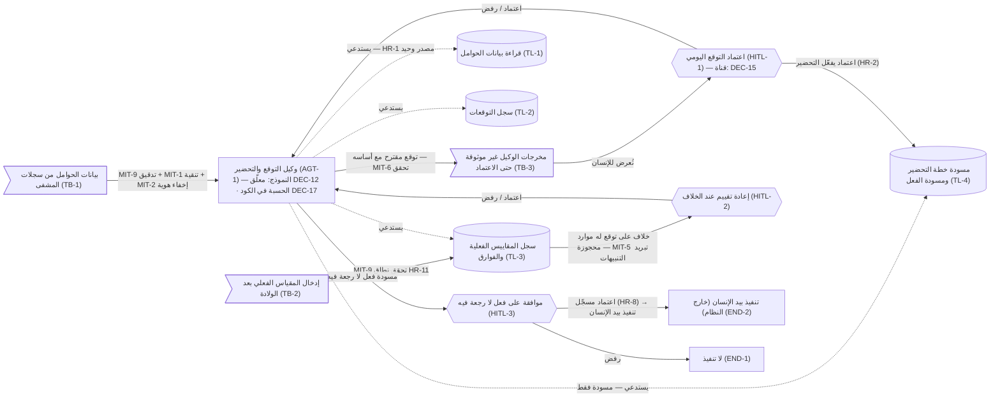

# Playbook: AGENTE — S2 Architecture & Threats

> للإنسان: القرارات وأسبابها والبدائل المرفوضة. يُقرأ مع AGENTE_s1_prd.md و AGENTE_decisions.md.

## 1. الصورة الكبيرة (60 ثانية)
كل صباح يفتح النظام **دورة**: يقرأ AGT-1 بيانات الحوامل (ولادتها خلال الأسبوع الأخير فقط — BR-5) من سجلات المشفى عبر TL-1 — المصدر الوحيد المسموح (K-5). يوازن المؤشرات ويحتسب توقع العدد وحالة كل طفل متوقع (apgar قيمة تُحتسب + فئة تُقاس — DEC-2 ج) ويثبته مع أساسه في TL-2. المخرجات تمر عبر TB-3 (غير موثوقة حتى الاعتماد) وتُعرض على صاحب الحضانة في HITL-1 (دفعة يومية + تنبيه فوري للحالات «الحرجة» = فئة الخطر الأعلى). عند الاعتماد فقط تُبنى مسودة خطة التحضير في TL-4. بعد كل ولادة يدخل المقياس الفعلي يدوياً عبر TL-3 (TB-2)، يُقارن بكل توقع معتمد ذي صلة (EV-6)، وكل خلاف يخص توقعاً له موارد محجوزة يُصعَّد إلى HITL-2. أي فعل لا رجعة فيه (نقل/تجهيز/إبلاغ) يبقى **مسودة** تُعرض على HITL-3: موافقة مسجلة → نهاية مسار النظام END-2 «تنفيذ بيد الإنسان خارج النظام» — أو رفض → END-1 «لا تنفيذ». **النظام لا ينفّذ شيئاً إطلاقاً (DEC-9)** — يقرأ ويسجّل ويقترح ويصعّد فقط.

## 2. الجراف المعماري

- حدود الثقة الثلاثة من S1 كما هي: TB-1 (استيراد)، TB-2 (إدخال يدوي)، TB-3 (مخرجات الوكيل).
- كل MIT موضوعة على مكان تنفيذها في الجراف أعلاه — تفاصيلها في نموذج التهديدات.

## 3. القرارات (ADR مصغّرة)
كل قرارات S2 أدناه **بانتظار توقيعك** — الجداول الكاملة في AGENTE_decisions.md §S2 (DEC-11..DEC-17).

### ADR-1: الإطار وطريقة التشغيل (DEC-11)
- **القرار المقترح:** بلا إطار — كود عادي (حلقة أدوات + استدعاءات نموذج + حالة في المخزن)، ودورة يومية مجدولة مع توقف عند نقاط HITL.
- **السبب:** النمط مقفل بوكيل واحد بأربع أدوات وبلا RAG (DEC-1 ج) — لا حاجة مثبتة لاعتماديات إطار؛ K-2 يفضل أقل عدد اعتماديات (سلسلة توريد — TH-9) وأسهل تدقيق.
- **البدائل المرفوضة (مبدئياً):** LangGraph — checkpoints وinterrupts جاهزة تناسب نقاط HITL، لكن ثمنها اعتمادية وتعلم إضافي لا يبرَّره حجم الجراف الآن؛ OpenAI/Claude Agent SDK — ارتباط بمزوّد واحد يقيّد DEC-13 لو اخترت استضافة محلية.
- **الأثر:** S3 يقطّع حلقة + 3 نقاط توقف؛ بدون إطار تكون المهام أوضح وأصغر.
- **يحتاج قرار بشري؟** نعم (DEC-11).

### ADR-2: نموذج AGT-1 (DEC-12)
- **القرار المقترح:** نموذج سحابي اقتصادي + الحسبة الحتمية في الكود (DEC-17 ج) — لأن الأرقام لا تولد من النموذج أصلاً؛ النموذج ينظّم الأساس ويوثّقه ويصعّد.
- **السبب:** DEC-2 ج نقل ثقل النجاح إلى الفئة المحتسبة؛ جودة الاستدلال المطلوبة توثيق وتصعيد لا حسبة؛ توفير مباشر في التكلفة مع MIT-2 للخصوصية.
- **البدائل المرفوضة:** نموذج قوي لكل شيء — تكلفة أعلى بلا فائدة مثبتة على الأرقام (محسوبة كوداً)؛ نموذج محلي — جودة أقل غالباً + بنية تحتية، ما لم تفرض الخصوصية قرارات DEC-13 (ج).
- **الأثر:** ترقية النموذج لاحقاً ممكنة دون تغيير الجراف لأن العقود مهيكلة.
- **يحتاج قرار بشري؟** نعم (DEC-12) — ⚠ قرار أمن وتكلفة.

### ADR-3: التخزين والحالة (DEC-14)
- **القرار المقترح:** SQLite — ملف واحد بلا خادم، استعلامات موثوقة لربط التوقعات بالمقاييس (EV-6/AC-6)، نسخ احتياطي بسيط.
- **السبب:** سجلان مرتبطان يحتاجان سلامة ربط؛ ملفات JSON تصبح هشة مع نمو السجلات؛ خادم قواعد بيانات بلا حاجة مثبتة في MVP.
- **البدائل المرفوضة:** ملفات JSON (الأبسط لكن أخطر على سلامة الربط)؛ PostgreSQL (نمو مستقبلي — الترقية ممكنة عند الحاجة).
- **الأثر:** مهام S3 تتضمن مخزناً واحداً + سجل تدقيق append-only.
- **يحتاج قرار بشري؟** نعم (DEC-14).

### ADR-4: مكان التشغيل والخصوصية (DEC-13)
- **القرار المقترح:** سحابي + إخفاء هوية كامل قبل أي استدعاء (MIT-2) — لا معرفات مباشرة تخرج (HR-10)؛ جدول الربط الحقيقي يبقى داخل المشفى ولا يخرج أبداً.
- **السبب:** أبسط تشغيلاً مع حماية حقيقية؛ يتفق مع K-2 (كما هو مفترض) وLLM02.
- **البدائل المرفوضة:** سحابي بلا إخفاء — مرفوض في سياق صحي؛ استضافة محلية كاملة — صفر خروج بيانات لكن جودة أقل + بنية تحتية وصيانة — تصبح الخيار الأول لو أكدت K-2 حساسية قصوى أو منعت أي خروج للبيانات.
- **الأثر:** يحدد أي خيار نموذج متسق في DEC-12؛ ⚠ قرار خصوصية وصحة.
- **يحتاج قرار بشري؟** نعم (DEC-13) — ⚠ يحتاج قرار بشري إلزاماً.

### ADR-5: قناة نقاط الإنسان (DEC-15)
- **القرار المقترح:** لوحة ويب محلية بسيطة — تعرض الدفعة والتنبيهات وتسجل كل قرار تلقائياً (HR-8).
- **السبب:** موافقة مسجلة شرط في BR-4/EV-5؛ قنوات الرسائل تجعل «من وافق؟» غير موثوق؛ DEC-5 ج يطلب دفعة + تنبيه فوري.
- **البدائل المرفوضة:** واتساب/بريد (تسجيل غير موثوق)؛ تقارير يدوية (بطيء ولا ينبّه فورياً).
- **الأثر:** مهمة واجهة واحدة في S3 + سجل تدقيق.
- **يحتاج قرار بشري؟** نعم (DEC-15).

### ADR-6: الحسبة الحتمية للأرقام (DEC-17)
- **القرار المقترح:** هجين — النموذج يقترح الأوزان/قاعدة الموازنة، الكود داخل AGT-1 يخرج القيمة والفئة ويسجل computation_ref في الأساس (HR-5).
- **السبب:** يطابق حرفياً «قيمة تُحتسب» (DEC-2 ج) ودور AGT-1 «يقرر كيف يوازن»؛ يقطع TH-4 (LLM09) من الجذر.
- **البدائل المرفوضة:** النموذج يولّد الأرقام مباشرة — مرفوض في سياق K-2؛ قواعد ثابتة كلياً — تصادم G-3 («يفكر عنه»).
- **الأثر:** S4 يبني محرك حسبة قابلاً للاختبار داخل AGT-1.
- **يحتاج قرار بشري؟** نعم (DEC-17).

> DEC-16 (حدود الحلقة/الاستهلاك — LLM10) قرار أمني ⚠: يوصى بسقوف ثابتة في الكود (HR-9) برقم تحدده أنت.

## 4. التكلفة والأداء
كل الأرقام أدناه **[تقدير]** — لا يوجد قيد مالي معلن في K-N؛ إن كان لديك سقف ميزانية فاذكره ليُقارن به.
- **طريقة الحساب:** تكلفة الدورة اليومية ≈ (عدد الحوامل whose ولادتها خلال الأسبوع الأخير — غير معلوم في المدخل؛ [افتراض] مدى 10–50 حامل/يوم) × (استدعاءات النموذج لكل توقع — [تقدير] 3–6 استدعاءات لدورة وكيل بأربع أدوات) × (سعر التوكن عند المزود وقت القراءة — يتغير؛ يُراجع عند التوقيع).
- **الخيار أ (سحابي اقتصادي — DEC-12 ب):** أرخص بترتيب مقارنة بالقوي؛ يكفي لأن الأرقام محسوبة كوداً.
- **الخيار ج (محلي — DEC-13 ج):** تكلفة التشغيل تتحول لعتاد/كهرباء/صيانة [تقدير] — أعلى تعقيداً، صفر خروج بيانات.
- **الزمن:** [تقدير] دورة على دفعة يومية: دقائق معدودة سحابياً؛ أبطأ محلياً حسب العتاد. التنبيه الفوري للحرجة يعمل داخل الدورة نفسها بلا انتظار الدفعة.

## 5. خريطة التدفق
**UF-1 — التوقع اليومي والتحضير:**
| الخطوة | العقدة | العقد | الحالة مقروءة/مكتوبة | HITL/TB |
|---|---|---|---|---|
| 1 | قراءة | C-1 (TL-1) | يقرأ cases[] | TB-1 + MIT-1/MIT-9/MIT-2 |
| 2 | توقع وتسجيل | C-2 (TL-2) | يكتب forecasts[] بأساس computation_ref | HR-5/HR-3 |
| 3 | عرض | C-5 (عبر TB-3) | يقرأ forecasts[] | TB-3 + MIT-6 + HITL-1 (DEC-5 ج) |
| 4 | قرار | — | يكتب human_decisions[] (الإنسان فقط) | HR-8 |
| 5 | مسودة تحضير | C-4 (TL-4) | يكتب drafts[] (kind=prep_plan) | HR-2 (توقع معتمد حصراً — EV-8/AC-8) |

**UF-2 — المقارنة بعد الولادة:**
| الخطوة | العقدة | العقد | الحالة | HITL/TB |
|---|---|---|---|---|
| 1 | إدخال المقياس | C-3 (TL-3) | يكتب measures[] | TB-2 + HR-11 (نطاق) + DEC-4 أ |
| 2 | مقارنة | C-3 → AGT-1 | يكتب variance في TL-3 | EV-6/AC-6 |
| 3 | تصعيد | C-6 (HITL-2) | يكتب escalations[] ثم قرار الإنسان | HR-7/HR-8 + MIT-5 (تبريد التنبيه) |

**UF-3 — فعل لا رجعة فيه:**
| الخطوة | العقدة | العقد | الحالة | HITL/TB |
|---|---|---|---|---|
| 1 | مسودة فعل | C-4 (TL-4) | يكتب drafts[] (kind=irreversible_action) | HR-2 + DEC-9 (لا تنفيذ) |
| 2 | موافقة | C-7 (HITL-3) | قرار مسجل → to_END2 أو to_END1 | HR-8 + BR-4 → END-1/END-2 |

## 6. كيف تتحقق أن S3/S4 التزما بهذه المعمارية
1. لا مهمة تنشئ أداة خامسة أو قناة مصدر غير TL-1 — أي طلب توسعة يُرفع لك كقرار جديد لا يُنفذ تلقائياً.
2. كل مهمة تلمس أرقاماً تفترض DEC-17 (الحسبة في الكود + computation_ref) — بلا توقيعك لا تُبنى.
3. كل مهمة تكتب في TL-4 تشترط توقعاً معتمداً (HR-2)، وكل نقطة HITL تسجل القرار (HR-8).
4. MIT-1/MIT-9 تظهران كمهام حقيقية (تنقية وتحقق نطاقات) لا كتعليقات أو «لاحقاً».
5. سقوف HR-9 مهام مخصصة بأرقام تحددها أنت (DEC-16) — لا أرقام افتراضية صامتة.
6. لا توجد أي مهمة تنفّذ فعلاً لا رجعة فيه — أي «نقل/تجهيز/إبلاغ» مسودة تنتهي عند HITL-3 حصراً (DEC-9).
7. ترتيب المهام يضع MIT-2 (إخفاء الهوية) قبل أي استدعاء نموذج — لا استدعاء يسبق الإخفاء.
