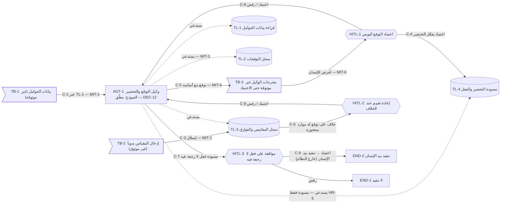

# Playbook: AGENTE — S2 Architecture & Threats
> للإنسان: القرارات المقترحة وأسبابها والبدائل المرفوضة. الملفات الشقيقة: skill (للمحركات) + api_contract (مصدر الحقيقة للعقود) + threat_model.

## 1. الصورة الكبيرة (60 ثانية)
كل صباح تُقرأ بيانات الحوامل من سجلات المشفى حصراً (TL-1) عبر عقدة ثقة TB-1 → **وكيل واحد (AGT-1)** يبني توقع عدد الخدج وحالتهم (قيمة + فئة — DEC-2) بأساس موثق، ويسجّله في TL-2، ويعرضه على صاحب الحضانة في **HITL-1** (دفعة يومية + تنبيه فوري للفئة «high» — DEC-5). بعد كل ولادة يُدخل المقياس الفعلي يدوياً (DEC-4 أ) عبر TB-2 → TL-3، ويقارنه الوكيل بالتوقع (EV-6)؛ أي خلاف يخص موارد محجوزة يُصعَّد فوراً في **HITL-2**. التحضير مسودة في TL-4 لا تلمس الواقع، ومسودة الفعل لا رجعة فيه تمر إلزامياً في **HITL-3**؛ الاعتماد ينقل التنفيذ **بيد الإنسان خارج النظام (END-2)** والرفض ينتهي بـ END-1 — **الوكيل بلا أي أداة تنفيذ (DEC-9)**.

## 2. الجراف المعماري

حدود الثقة الثلاثة (TB-1/TB-2/TB-3) كما في S1 — لا حدود جديدة؛ قناة HITL (DEC-16) امتداد لمسار القرار البشري في TB-2/C-8.

## 3. القرارات (ADR مصغّرة)
### ADR-1: الإطار وطريقة التشغيل (DEC-11 — معلّق)
- **القرار المقترح:** بلا إطار — كود عادي + حلقة أدوات بسيطة.
- **السبب:** DEC-1 قفل النمط «وكيل واحد بأدوات»؛ HITL هنا دفعات يومية غير متزامنة لا مقاطعات داخل حلقة — فلا حاجة لـ state/checkpoints جاهزة؛ K-2 يفضل قابلية تدقيق قصوى.
- **البدائل المرفوضة:** LangGraph (قوة interrupts زائدة عن الحاجة وتعقيد تدقيق أكبر) — SDK رسمي (يربط بمزوّد واحد ويقيّد DEC-12).
- **الأثر:** S3 يقطّع مكونات أقل؛ S4 أبسط؛ صفر رسوم إطار.
- **يحتاج قرار بشري؟** نعم — DEC-11.

### ADR-2: النموذج لكل عقدة (DEC-12 — معلّق)
- **القرار المقترح:** نموذج سحابي قوي واحد لـ AGT-1 (الأدوات بلا نماذج).
- **السبب:** جودة التوازن بين المؤشرات وصياغة الأساس تخدم SC-1/SC-2 وK-2؛ الحجم اليومي صغير فالتكلفة هامشية [تقدير — §4].
- **البدائل المرفوضة:** نموذج اقتصادي (خطر على عتبة ≥85% للفئة) — نموذج محلي (جودة أقل + عبء تشغيل؛ يبقى خيار الترقية إن رُفض الخروج).
- **الأثر:** تكلفة شهرية بسيطة؛ يعتمد على DEC-13 (ما الذي يخرج فعلاً).
- **يحتاج قرار بشري؟** نعم — DEC-12.

### ADR-3: الخصوصية وإخفاء الهوية (DEC-13 — معلّق ⚠)
- **القرار المقترح:** إخفاء الهوية قبل النموذج (مرجع رقمي) والمخرجات بالمرجع فقط (MIT-5/HR-5).
- **السبب:** بيانات صحية (K-2 [افتراض]) — يقلل الانكشاف جذرياً دون التضحية بجودة النموذج السحابي.
- **البدائل المرفوضة:** إرسال كامل بالمعرفات (LLM02 غير مقبول) — نموذج محلي كلي (يرتبط بـ DEC-12 ج؛ أثقل تشغيلياً).
- **الأثر:** كل استدعاء نموذج يمر عبر طبقة إخفاء؛ خريطة الارتباط تصبح أصلاً حساساً محلياً.
- **يحتاج قرار بشري؟** نعم — قرار خصوصية/أمن.

### ADR-4: مكان التشغيل (DEC-14 — معلّق ⚠)
- **القرار المقترح:** خادم/جهاز داخل بيئة المشفى أو شبكة صاحب الحضانة.
- **السبب:** K-5/K-2 — إبقاء السجلات داخلياً؛ الوصول الخارجي الوحيد = مزوّد النموذج عبر MIT-5.
- **البدائل المرفوضة:** سحابة صغيرة/PaaS (بيانات صحية خارج المشفى تحتاج ضوابط وموافقات أثقل).
- **الأثر:** يحتاج من يدير الخادم + نسخاً احتياطياً.
- **يحتاج قرار بشري؟** نعم — قرار تكلفة/خصوصية.

### ADR-5: التخزين (DEC-15 — معلّق)
- **القرار المقترح:** SQLite ملف محلي واحد + نسخ احتياطي مجدول.
- **السبب:** أبسط، محلي (يكمل DEC-14 أ)، كافٍ لسجلات دورية بحجم صغير، استعلامات تكفي حلقة المقارنة.
- **البدائل المرفوضة:** PostgreSQL (تزامن زائد عن حاجة فريق صغير) — مخزن سحابي (يتعارض مع اتجاه DEC-14 أ).
- **الأثر:** S4 يبني طبقة تخزين واحدة بسيطة.
- **يحتاج قرار بشري؟** نعم — DEC-15.

### ADR-6: قناة HITL (DEC-16 — معلّق)
- **القرار المقترح:** واجهة ويب داخلية بسيطة مع تسجيل هوية الموافق وسببه.
- **السبب:** الموافقات (BR-4) قرارات مسجلة تُبنى عليها أفعال لا رجعة فيها — قابلية التدقيق أهم من الراحة؛ عرض الأساس والنواقص يحتاج مساحة.
- **البدائل المرفوضة:** واتساب/تيليجرام (توثيق أضعف وهوية أصعب إثباتاً) — بريد بروابط (تتبع متشتت).
- **الأثر:** جهد تطوير واجهة في S4.
- **يحتاج قرار بشري؟** نعم — DEC-16.

### ADR-7: استراتيجية الحماية من الحقن والمخرجات غير الموثوقة (DEC-17 — معلّق ⚠)
- **القرار المقترح:** منع عند الحد — قالب بيانات صارم (MIT-1) + حقول مقيدة في TL-3 (MIT-2) + تحقق مخرجات قبل الكتابة/العرض (MIT-4).
- **السبب:** الأبسط والأقوى قابليّة للاختبار الهجومي (RT-1..RT-5)، ويحقق EV-2/EV-3 حرفياً؛ كل تجاوز يُصعَّد للإنسان.
- **البدائل المرفوضة:** نموذج مراجع ثانٍ (يضاعف التكلفة والتعقيد فوق حاجة وكيل واحد) — فلتر حقن خارجي (اعتماد طرف ثالث LLM03 ولا يغني عن التحقق البنيوي).
- **الأثر:** HR-1/HR-2/HR-3 تُنفَّذ في S4 داخل العقود.
- **يحتاج قرار بشري؟** نعم — قرار أمن.

### ADR-8: سقوف الاستهلاك (DEC-18 — معلّق ⚠)
- **القرار المقترح:** سقوف ثابتة بسيطة + مفتاح إيقاف يدوي دائم (MIT-7/HR-4).
- **السبب:** يكفي لحجم يومي صغير ويختبر بـ RT-4؛ «بلا سقوف» = قبول خطر LLM10 صراحة.
- **البدائل المرفوضة:** ميزانية توكنز ديناميكية (تعقيد إدارة زائد).
- **يحتاج قرار بشري؟** نعم — قرار أمن/تكلفة.

## 4. التكلفة والأداء
**طريقة الحساب [تقدير]:** دورة يومية = قراءة TL-1 (بلا توكنز) + بناء التوقع لدفعة النافذة الأسبوعية (نفترض 5–20 حامل/أسبوع [افتراض حجم] في استدعاء واحد: مدخل ≈4–8K توكن بيانات+قواعد، مخرج ≈1–2K) + مقارنة بعد كل ولادة (≈1–2K/ولادة) + مسودة فعل عند الحاجة (≈2–3K). **المجموع ≈10–15K توكن/يوم [تقدير]** — على نموذج سحابي اقتصادي: تكلفة شهرية في حد الأدنى؛ على نموذج reasoning قوي: أعلى بمرات لكنه ما زال بسيطاً بهذا الحجم. **الأسعار تتغير — تُراجع عند وقت القرار DEC-12.** لا يوجد قيد مالي K-N معلن في المدخل — يُرفع للقرار. زمن الدورة: ثوانٍ معدودة لكل استدعاء؛ الزمن الحاكم هو استجابة الإنسان في HITL [تقدير].

## 5. خريطة التدفق
**UF-1 التوقع اليومي والتحضير:** ① جدولة الدفعة (بلا نموذج) → ② C-1 عبر TL-1 (TB-1/MIT-1) — يكتب: pregnant_cases → ③ AGT-1 يبني التوقع (DEC-2/BR-5) ويكتب prediction_draft بعد MIT-4 عبر C-2 (TL-2) → ④ C-5 عبر TB-3 → HITL-1 (دفعة يومية + تنبيه فوري إذا risk_class=high — DEC-5 ج؛ HR-3/MIT-6) → ⑤ C-8 قرار الإنسان (يكتب approval) → ⑥ عند الاعتماد: C-4 تفعيل TL-4 — يكتب preparation_draft (EV-8/AC-8 — مسودة فقط). **الحالات الحافة:** بيانات ناقصة → نواقص موثقة (EV-2)؛ فشل TL-1 → توقف الدور بلا توقع بديل؛ لم يرد الإنسان → التوقع معلق (BR-1).

**UF-2 المقارنة بعد الولادة:** ① إدخال يدوي C-3 → TL-3 (TB-2/MIT-2 — apgar 0..10) — يكتب actual_outcomes → ② AGT-1 يقرأ TL-3 ويقارن (EV-6) ويكتب discrepancies في TL-3 (عتبات DEC-3: ≥80% عدد، ≥85% فئة) → ③ خلاف على توقع له موارد محجوزة → C-6 → HITL-2 (EV-4/EV-7 — K-2) → ④ قرار C-8 (إعادة تقييم/تعديل توزيع/إبقاء مع سبب مسجل). **الحالات الحافة:** مقياس بلا توقع مطابق → فارق غير مبرمج مسجل؛ لم يرد الإنسان → تنبيه متكرر (K-2).

**UF-3 فعل لا رجعة فيه:** ① AGT-1 يكتب ActionDraft في TL-4 على توقع معتمد حصراً (C-4 — HR-6) → ② C-7 عرض → HITL-3 → ③ C-9: اعتماد → **END-2 تنفيذ بيد الإنسان خارج النظام** / رفض → **END-1 لا تنفيذ** (BR-4/EV-5/DEC-9 — لا عودة للوكيل). **الحالات الحافة:** لم يرد الإنسان → الفعل لا يُنفَّذ.

## 6. كيف تتحقق أن S3/S4 التزما بهذه المعمارية
1. لا توجد في مهام S3 أي مهمة لأداة تنفيذ أو تكامل تنفيذي — المسودات في TL-4 فقط (DEC-9/HR-6).
2. كل مهمة كتابة في السجلات تحمل قيد التحقق البنيوي (HR-2/MIT-4) وقفل المعتمد (HR-7).
3. مهمة مخصصة لطبقة إخفاء الهوية قبل استدعاء النموذج (MIT-5/HR-5) — إن قررتَ DEC-13.
4. مهمة مخصصة لسقوف الاستهلاك ومفتاح الإيقاف (HR-4/MIT-7).
5. الحالة في الكود مطابقة حرفياً لحقول api_contract — لا حقول مخترعة.
6. عتبات DEC-3 (≥80%/≥85%/صفر خلاف بلا تصعيد) مبرمجة في منطق المقارنة في TL-3/AGT-1.
7. لا مصدر بيانات غير TL-1 في أي مهمة (BR-3/EV-3)، والحقول الناقصة توثَّق ولا تُملأ (EV-2).
